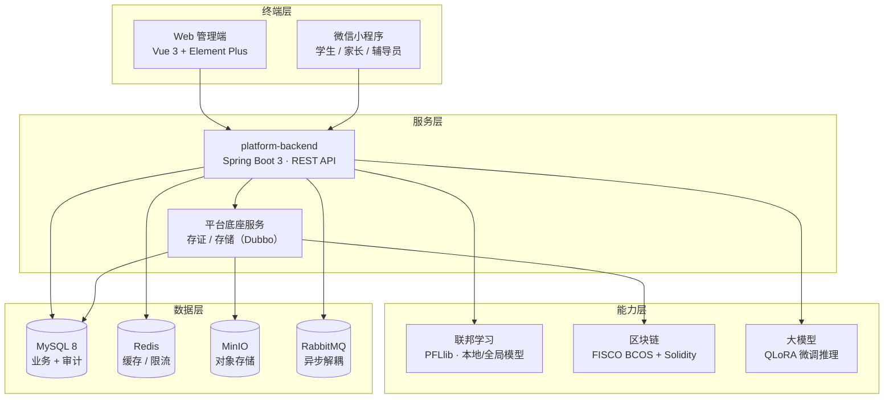

# 人工智能赋能的大学生心理健康「家校医」一体化平台

> Privacy-Preserving Federated Learning + Blockchain Attestation + LLM Fine-tuning，面向大学生心理健康筛查、辅助诊断与家校医协同干预的一体化平台。


**在线演示：** <https://super-vacherin-e44237.netlify.app/>

简体中文 | [English](./README_EN.md)

---

## 目录

- [一、项目背景](#一项目背景)
- [二、核心特性](#二核心特性)
- [三、系统架构](#三系统架构)
- [四、技术栈](#四技术栈)
- [五、仓库结构](#五仓库结构)
- [六、快速开始](#六快速开始)
- [七、功能模块](#七功能模块)
- [八、联邦学习与大模型微调](#八联邦学习与大模型微调)
- [九、数据存储与设计](#九数据存储与设计)
- [十、创新点](#十创新点)
- [十一、已知问题与后续规划](#十一已知问题与后续规划)
- [十二、致谢与许可](#十二致谢与许可)

---

## 一、项目背景

大学生心理健康问题具有高发性、隐蔽性和强隐私性三个特征，现有工作普遍存在以下痛点：

| 痛点 | 说明 | 本平台的应对 |
| --- | --- | --- |
| **数据孤岛** | 校医院、心理中心、院系辅导员、家长各自掌握一部分信息，难以形成完整画像 | 「家校医」一体化多端协同：Web 端（医生 / 心理咨询中心 / 管理员）+ 微信小程序（学生 / 家长 / 辅导员） |
| **隐私合规风险** | 心理量表、诊断记录属敏感个人信息，集中建模存在泄露风险 | 引入**个性化联邦学习**，原始数据不出机构，仅交换模型参数/梯度 |
| **记录易被篡改** | 评估结论、转诊记录缺乏可信时间戳与责任归属 | **FISCO BCOS 区块链存证**：文件哈希、分享授权上链，可验真、可追溯 |
| **筛查效率低** | 依赖人工量表判读，缺少智能化辅助 | 大模型微调 + 多模型（CNN+LSTM / ResNet+Attention / Transformer+BERT）辅助诊断与 AI 报告生成 |

---

## 二、核心特性

### 🔐 隐私计算：个性化联邦学习

- 各参与机构（校医院、心理中心、合作医院）在本地训练**本地模型**，只上传模型参数。
- 支持「加入个性化模型 / 加入全局模型」两种协同策略，兼顾**个性化**与**泛化性**。
- 前端可视化每一轮联邦训练的**梯度、机构评分、激励值**，训练过程透明可审计。

### ⛓️ 区块链存证：不可篡改的责任链

- 基于 **FISCO BCOS** 国产联盟链，Solidity 合约 `Storage.sol` / `Sharing.sol`。
- 心理评估文件、转诊单据的 **fileHash** 与 **contractHash（交易哈希）** 落库并上链。
- 提供**带过期时间的分享码**（≤30 天）机制，实现跨机构可控共享。
- 内置**区块链监控面板**：多群组切换、区块高度、交易数、模型运行情况实时展示。

### 🧠 AI 辅助：大模型 + 多模型诊断

- **QLoRA 微调**：以 `DeepSeek-R1-Distill-Qwen-1.5B` 为基座，4-bit 量化 + LoRA（r=16），可训练参数占比 **0.2651%**，单卡即可完成训练。
- 基于 **DIU Extended Mental Health** 数据集（孟加拉大学生，约 2038 条，含 GAD-7 / PSS-10 / DASS-21 量表）构造心理健康领域指令微调数据。
- 前端提供 PHQ-9、LSAS、IAT、SAD PERSONS 等量表录入，生成 **AI 心理健康报告**（ECharts 折线 / 柱状 / 雷达 / 饼图）与 **DSM-5 五轴转诊建议书**。

### 📱 多端协同

- **Web 管理端**：医生工作台、心理中心工作台、管理员（模型管理 / 用户管理）、区块链监控。
- **微信小程序**：学生自评与互助社区、家长关注视图、辅导员预警清单。

---

## 三、系统架构



**一次心理评估的数据流：**

1. 心理中心 / 医生在 Web 端录入量表（PHQ-9 / LSAS / IAT）与用户画像；
2. 本地模型给出辅助诊断结论，生成 AI 报告；
3. 评估文件分片上传 → MinIO 落盘 → 计算 `fileHash`；
4. 调用区块链服务将哈希与元信息写入 FISCO BCOS，回写 `contractHash`；
5. 全过程写入 `sys_operation_log`，管理员可在审计面板按人 / 按模块 / 按时间回溯，并导出 Excel。

---

## 四、技术栈

| 层次 | 技术 | 版本 |
| --- | --- | --- |
| Web 前端 | Vue 3、Vue Router、Pinia、Element Plus、ECharts、Axios、Vite、Less | 3.4 / 4.4 / 2.1 / 2.7 / 5.5 / 1.7 / 5.3 |
| 小程序 | 微信小程序原生（WXML / WXSS / JS） | — |
| 后端 | Java、Spring Boot 3、Spring Security + JWT、Spring Mail、Apache POI | 21、3.2.11、5.2.5 |
| 服务治理 | Apache Dubbo（Triple 协议）、Nacos | 3.3.3 |
| 持久层 | MyBatis-Plus、MySQL、Druid | 3.5.9、8.x、1.2.23 |
| 中间件 | Redis、RabbitMQ、MinIO | — |
| 接口文档 | SpringDoc OpenAPI + Knife4j | — |
| 区块链 | FISCO BCOS Java SDK、Solidity、Web3j | 3.8.0、^0.8.11 |
| 联邦学习 | PFLlib（PyTorch） | — |
| 大模型 | DeepSeek-R1-Distill-Qwen-1.5B、PEFT / LoRA、bitsandbytes（4-bit QLoRA）、Transformers | — |

---

## 五、仓库结构

```
psychology-healthy-platform/
├── platform-frontend/          # Web 管理端（Vue 3 + Vite + Element Plus）
│   └── src/
│       ├── views/              # 页面框架：登录、医生端、心理中心端、管理员端、模型详情
│       ├── components/         # 业务组件：病历、画像、诊断、AI 报告、转诊、区块链监控…
│       ├── net/                # Axios 封装与后端接口
│       ├── router/             # 路由与守卫
│       └── store/              # Pinia 状态
├── platform-backend/           # 后端（Spring Boot 3 多模块 Maven）
│   ├── backend-web/            # Controller、JWT 过滤器、限流、AOP 操作日志
│   ├── backend-service/        # 业务逻辑
│   ├── backend-dao/            # MyBatis-Plus Entity / Mapper
│   ├── backend-api/            # Dubbo 接口定义
│   ├── backend-common/         # 公共常量与工具类
│   └── db/migration/           # 建表、视图、存储过程、审计配置
├── mini-program/               # 微信小程序（学生 / 家长 / 辅导员）
├── llm-finetune/               # 大模型微调（QLoRA 脚本 + 心理健康指令数据集）
├── federated-learning/         # 联邦学习实验说明与运行结果
├── docs/                       # 项目文档与申报材料
│   ├── ARCHITECTURE.md
│   ├── GETTING_STARTED.md
│   ├── DATABASE.md
│   ├── API.md
│   ├── BLOCKCHAIN.md
│   ├── FEDERATED_LEARNING.md
│   ├── LLM_FINETUNE.md
│   ├── MINI_PROGRAM.md
│   └── assets/                 # 项目申报书 / 答辩 PPT
└── LICENSE
```

---

## 六、快速开始

### 6.1 环境依赖

| 组件 | 版本 | 用途 |
| --- | --- | --- |
| JDK | 21 | 后端编译运行 |
| Maven | 3.9+ | 后端构建 |
| Node.js | 18+（推荐 20 LTS） | 前端构建 |
| MySQL | 8.0+ | 业务库 |
| Redis | 7.x | 缓存、限流 |
| RabbitMQ | 3.x | 异步消息 |
| MinIO | 最新版 | 对象存储 |
| Nacos | 2.x | 注册中心 |
| FISCO BCOS | 3.x | 联盟链节点 |
| Python | 3.10+（可选） | 联邦学习 / 微调实验 |

### 6.2 启动前端

```bash
cd platform-frontend
npm install
npm run dev          # http://localhost:8080
npm run build        # 产物输出到 dist/
```

### 6.3 启动后端

> ⚠️ 后端通过 Dubbo 依赖底座服务（`platform-api` 中的 `DistributedStorageService` 等接口）与区块链服务。
> 首次构建前请先安装共享接口模块（来自协作仓库 [SoarCollab/RecordPlatform](https://github.com/SoarCollab/RecordPlatform)）：

```bash
# 1) 克隆并安装共享 Dubbo 接口到本地仓库
git clone https://github.com/SoarCollab/RecordPlatform.git
mvn -f RecordPlatform/platform-api/pom.xml clean install

# 2) 依次启动底座服务（区块链服务 platform-fisco、存储服务 platform-storage）

# 3) 构建并启动本项目后端
cd platform-backend
mvn clean package -DskipTests
java -jar backend-web/target/backend-web-*.jar --spring.profiles.active=local
```

数据库初始化：

```bash
mysql -u root -p -e "CREATE DATABASE RecordPlatform DEFAULT CHARACTER SET utf8mb4;"
mysql -u root -p RecordPlatform < platform-backend/db/migration/V1.0_Entity.sql
mysql -u root -p RecordPlatform < platform-backend/db/migration/V1.0_Operation_Log.sql
mysql -u root -p RecordPlatform < platform-backend/db/migration/V1.0_Audit.sql
```

启动后访问：

- Knife4j 接口文档：<http://localhost:8080/doc.html>
- 健康检查：<http://localhost:8080/actuator/health>

> 更详细的配置说明（含环境变量、配置文件样例）见 [docs/GETTING_STARTED.md](./docs/GETTING_STARTED.md)。

### 6.4 启动小程序

使用微信开发者工具导入 `mini-program/` 目录，AppID 选择「测试号」即可预览（当前为纯前端 Mock 数据，无需后端）。

---

## 七、功能模块

### 7.1 Web 管理端

| 角色 | 路由 | 功能 |
| --- | --- | --- |
| 通用 | `/` | 登录、注册、邮箱验证码找回密码 |
| 医生 / 校医院 | `/index` | 病人档案查询、历史病历、新增病历（PHQ-9 / LSAS / IAT）、用户画像采集、辅助诊断、AI 心理健康报告 |
| 心理咨询中心 | `/counselor` | 学生档案、心理评估、DSM-5 五轴转诊建议书（SAD PERSONS 风险评分） |
| 管理员 | `/admin` | 联邦模型管理（本地 / 协同模型的训练、停止、验证、下载）、用户管理、模型详情（参与机构、每轮梯度 / 评分 / 激励） |
| 通用 | `/current` | 当前联邦训练任务，可「加入个性化 / 加入全局」 |
| 通用 | `/monitor` | FISCO BCOS 区块链监控（多群组、区块与交易数、模型运行情况） |

### 7.2 微信小程序

| 页面 | 说明 |
| --- | --- |
| `login` | 身份选择：学生 / 家长 / 辅导员 |
| `index` | 家长 / 辅导员视角的**关注学生列表**（良好 / 正常 / 需关注 / 预警） |
| `detail` | 单个学生的心理详情 |
| `questionnaire` / `questionnaire_detail` | 心理测评量表（焦虑 / 压力 / 抑郁）与答题 |
| `appointment` | 预约医生 |
| `community` / `compose` / `comments` | 社区互助：分类浏览、发帖、点赞、评论 |
| `advice` | 学生端心理建议与互助帖 |

---

## 八、联邦学习与大模型微调

### 8.1 个性化联邦学习

基于开源算法库 **PFLlib**（34 种 tFL/pFL 算法：FedAvg、FedProx、MOON、FedBN、Ditto、pFedMe …）开展实验：
机构本地训练 → 只交换模型参数 → 服务端聚合 → 下发全局模型 → 客户端再做个性化适配。
实验输出与复现命令见 [docs/FEDERATED_LEARNING.md](./docs/FEDERATED_LEARNING.md) 与 `federated-learning/results/`。

### 8.2 领域大模型微调

- 基座模型：`deepseek-ai/DeepSeek-R1-Distill-Qwen-1.5B`
- 方法：4-bit **QLoRA**（nf4 + 双重量化，`r=16`、`lora_alpha=32`、`target_modules=[q_proj,k_proj,v_proj]`），`paged_adamw_8bit` 优化器
- 训练：3 epoch，batch 4 × grad_accum 4，lr 1e-4，max_len 384；492 步耗时约 2h36m，loss 8.196 → 4.874
- 可训练参数：2,981,888 / 1,124,972,032 = **0.2651%**
- 数据构造脚本：`llm-finetune/mental_health_dataset.py`（按关键词判定 anxiety / stress / depression 并生成共情式回复）

详见 [docs/LLM_FINETUNE.md](./docs/LLM_FINETUNE.md)。

---

## 九、数据存储与设计

核心表与能力：

| 对象 | 类型 | 说明 |
| --- | --- | --- |
| `account` | 表 | 用户账户（用户名 / 邮箱 / 角色 / 头像 / 逻辑删除） |
| `file` | 表 | 文件元信息，含 `file_hash`、`contract_hash`（链上交易哈希）、`status`（上链状态）、`origin` |
| `image_store` | 表 | 图片存储 |
| `sys_operation_log` | 表 | 操作日志（模块 / 操作类型 / URL / IP / 入参 / 响应 / 耗时 / 状态） |
| `sys_audit_config` | 表 | 审计配置（日志保留 180 天、高频阈值 100 次 / 小时、失败登录阈值 5 次） |
| `v_high_frequency_operations` 等 | 视图 | 高频操作、敏感操作、错误统计、用户时间分布 |
| `proc_clean_old_operation_logs` 等 | 存储过程 | 日志清理、按月分区、异常检测、备份、导出 |

完整说明见 [docs/DATABASE.md](./docs/DATABASE.md)，接口清单见 [docs/API.md](./docs/API.md)。

---

## 十、创新点

1. **「家校医」三端闭环**：学生自评 → 辅导员预警 → 家长知情 → 心理中心评估 → 医院转诊，信息在同一平台内有序流转。
2. **隐私优先的建模范式**：个性化联邦学习让各机构「数据不动模型动」，配合区块链存证形成完整责任链。
3. **可解释的激励机制**：每轮联邦训练公开各机构的梯度贡献、评分与激励值，解决多机构协作中的贡献度量问题。
4. **轻量化的领域大模型**：QLoRA 单卡微调 1.5B 模型，训练参数仅 0.27%，便于在高校本地环境部署。
5. **全链路审计**：AOP 操作日志 + 存储过程/事件的异常检测 + Excel 导出，满足敏感数据的合规要求。

---

## 十一、已知问题与后续规划

当前为竞赛 / 原型阶段，以下问题已在 Roadmap 中：

- [ ] 小程序端目前为本地 Mock 数据，需接入真实后端接口
- [ ] 后端 `application-local.yml` 需按本地环境补齐（`application.yml` 默认激活 `local` profile）
- [ ] 前端登录校验 `unauthorized()` 目前恒返回 `false`（调试态），需恢复真实鉴权
- [ ] 联邦学习与大模型推理服务尚未封装为独立微服务，需补充任务调度与模型仓库
- [ ] 补充单元测试与自动化测试覆盖率

---

## 十二、致谢与许可

- 本项目的区块链存证与分布式存储底座基于协作项目 **[SoarCollab/RecordPlatform](https://github.com/SoarCollab/RecordPlatform)**（Apache-2.0）演进而来，在此感谢原作者团队。
- 联邦学习实验基于 **[PFLlib](https://github.com/TsingZ0/PFLlib)**（Zhang et al., arXiv:2312.04992）。
- 心理健康数据集来自 **DIU Extended Mental Health Dataset**（CC BY 4.0），见 `llm-finetune/dataset/`。

本项目代码基于 **Apache License 2.0** 发布，详见 [LICENSE](./LICENSE)。
