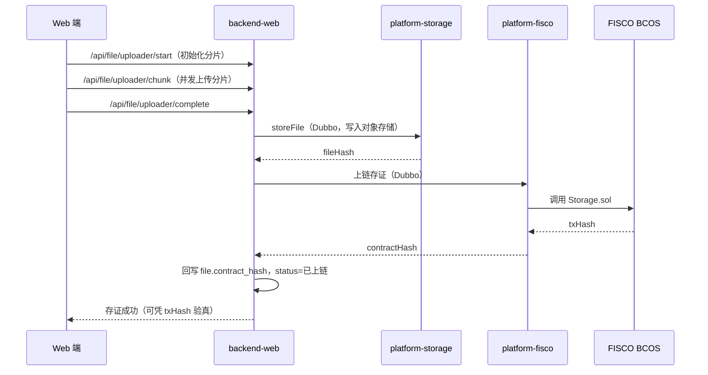
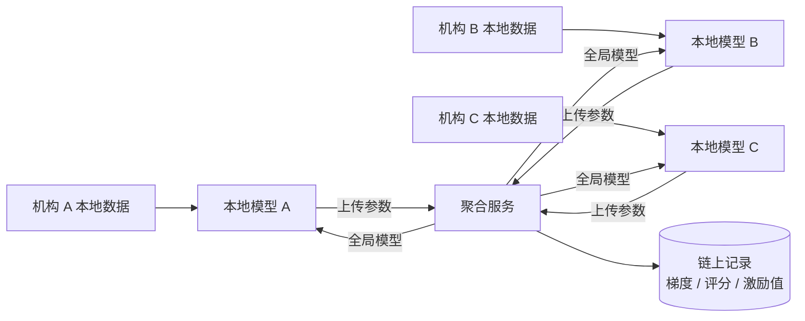

# 系统架构设计

## 1. 总体架构

平台采用「多端接入 + 微服务后端 + 隐私计算 / 区块链 / 大模型能力层」的分层架构。

```mermaid
graph TB
    subgraph 终端层
        A1["Web 管理端<br/>医生 / 心理中心 / 管理员"]
        A2["微信小程序<br/>学生 / 家长 / 辅导员"]
    end

    subgraph 接入与安全
        B0["CORS · 限流 Filter · JWT Filter · ID 混淆 Filter"]
    end

    subgraph 后端 platform-backend
        B1["backend-web<br/>Controller / 全局异常 / 参数校验"]
        B2["backend-service<br/>业务逻辑 + AOP 操作日志"]
        B3["backend-dao<br/>MyBatis-Plus Entity / Mapper"]
        B4["backend-api<br/>Dubbo 接口（Triple）"]
        B5["backend-common<br/>常量 / 工具类"]
    end

    subgraph 底座服务（Dubbo Provider）
        C1["platform-fisco<br/>FISCO BCOS 存证"]
        C2["platform-storage<br/>分布式对象存储"]
    end

    subgraph 基础设施
        D1[("MySQL")]
        D2[("Redis")]
        D3[("RabbitMQ")]
        D4[("MinIO / S3")]
        D5[("Nacos")]
        D6[("FISCO BCOS")]
    end

    A1 --> B0 --> B1
    A2 --> B0
    B1 --> B2 --> B3 --> D1
    B2 --> B4
    B4 -.Dubbo RPC.-> C1
    B4 -.Dubbo RPC.-> C2
    B2 --> D2
    B2 --> D3
    C1 --> D6
    C2 --> D4
    B1 --> D5
```

## 2. 后端模块划分

| 模块 | 职责 | 关键依赖 |
| --- | --- | --- |
| `backend-web` | REST 入口：Controller、Spring Security 配置、JWT 过滤器、限流 / CORS / 请求日志 / ID 安全过滤器、AOP 切面、全局异常处理 | spring-boot-starter-web / validation / actuator / mail、Apache POI、Knife4j |
| `backend-service` | 业务实现，编排 DAO 与远程 Dubbo 服务 | backend-dao、backend-api、platform-api |
| `backend-dao` | 数据访问层 | MyBatis-Plus 3.5.9、MySQL Connector/J 8.4、Druid 1.2.23 |
| `backend-api` | Dubbo 接口定义（注册中心 Nacos，协议 Triple） | dubbo 3.3.3、dubbo-nacos-spring-boot-starter |
| `backend-common` | 公共常量、工具类、统一响应体 | Lombok、Hutool |

> 父 POM：`groupId=cn.flyingcoding`、`artifactId=platform-backend`、Spring Boot `3.2.11`、Java `21`，打包方式 `pom`。

## 3. 关键设计

### 3.1 安全与鉴权

- **Spring Security + 自研 JWT**：`JwtAuthenticationFilter` 解析 `Authorization: Bearer <token>`，Token 有效期 72 小时。
- **限流**：`FlowLimitingFilter`，周期 3s / 阈值 50 次 / 封禁 30s；邮箱验证码 60s 冷却。
- **ID 混淆**：`IdSecurityFilter` + `SecureIdAspect` 做外部 ID ↔ 内部 ID 的 AES 映射，避免自增 ID 泄露业务规模。
- **操作日志**：`OperationLogAspect` 记录模块、操作类型、URL、IP、入参、响应、耗时，落 `sys_operation_log`。

### 3.2 文件与存证链路



### 3.3 联邦学习协同



- 机构可选择「加入个性化模型」或「加入全局模型」；
- 每轮训练的梯度贡献、机构评分与激励值写入链上，前端 `/admin/model-detail/:id` 可视化。

### 3.4 审计与合规

- 视图：`v_high_frequency_operations`（1 小时内 >100 次）、`v_sensitive_operations`（删除 / 修改 / 重置 / 权限类）、`v_error_operations_stats`、`v_user_time_distribution`。
- 存储过程：`proc_query_logs_by_operation_type`、`proc_export_logs`、`proc_check_operation_anomalies`、`proc_backup_operation_logs`、`proc_create_monthly_log_partition`。
- MySQL 事件：`evt_create_monthly_partition`、`evt_daily_check_anomalies`。

## 4. 前端结构

```
platform-frontend/src/
├── main.js                 # 应用入口
├── App.vue
├── net/index.js            # Axios 实例、鉴权、接口方法
├── router/index.js         # 路由表 + 全局守卫
├── store/                  # Pinia
├── views/                  # 页面框架（Welcome / Index / Counselor / Admin / ModelDetail / Start）
└── components/             # 业务组件
    ├── DoctorPanel / AdminPanel      # 首页面板、发起训练抽屉
    ├── PatientIdInput / MedicalHistory / NewMedical
    ├── UserProfile / Diagnosis / AIReport / ReferralSuggestion
    ├── currentTask / index / struct/* # 联邦任务 + 区块链监控
    └── counselor/*                    # 心理中心端定制组件
```

路由清单见 `src/router/index.js`，主要包括 `/`、`/index/*`、`/counselor/*`、`/current`、`/monitor`、`/admin`、`/admin/model-detail/:id`。
