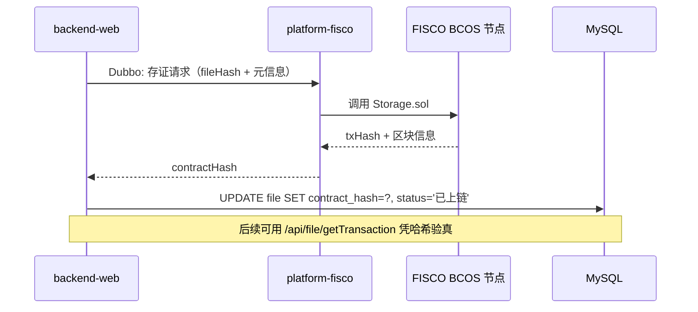

# 区块链存证设计

心理评估记录、转诊单据属于高度敏感数据，平台引入国产联盟链 **FISCO BCOS** 做「哈希上链、原文本地」的存证设计，保证**不可篡改、可验真、可追溯**，同时避免原始心理数据出域。

## 1. 为什么用区块链

| 需求 | 区块链能力 |
| --- | --- |
| 评估结论不能被事后修改 | 链上数据不可篡改，写入即留痕 |
| 明确责任归属与时间戳 | 交易哈希 + 区块时间 = 天然时间戳与签名 |
| 跨机构共享需授权可审计 | 带过期时间的分享码合约，授权行为全部上链 |
| 多机构协作贡献可量化 | 联邦训练每轮的梯度 / 评分 / 激励值写入链上 |

## 2. 合约设计（Solidity）

### `Storage.sol` — 文件存证主合约

```solidity
struct File {
    string  fileName;
    string  uploader;
    string  content;
    string  param;
    bytes32 fileHash;
    uint256 uploadTime;
}

mapping(bytes32 => File)        files;      // fileHash -> File
mapping(string  => bytes32[])   userFiles;  // uploader -> fileHash[]
```

- `generateFileHash()`：`keccak256(fileName, uploader, content, param, timestamp)`
- `storeFile()`：非空校验 + 去重校验，写入映射并抛出 `FileStored` 事件
- `getFile()`：校验归属后返回文件信息
- `getUserFiles()`：按上传者批量查询
- `deleteFile()` / `deleteFiles()`：删除与批量删除（采用「末位元素填补空位」的 O(1) 删除技巧）

### `Sharing.sol` — 授权分享合约（`contract Sharing is Storage`）

```solidity
struct ShareInfo {
    string    uploader;
    bytes32[] fileHashes;
    uint256   expireTime;
    bool      isValid;
}
```

- `generateShareCode()`：基于区块信息与 nonce 生成 6 位随机分享码
- `shareFiles()`：逐个校验所有权后生成分享码（有效期 ≤ 30 天），抛出 `FileShared` 事件
- `getSharedFiles()`：按分享码取回分享者、文件列表与过期时间（校验有效性与过期）

## 3. 数据流



## 4. 数据库侧的映射

`file` 表中三个关键字段与链上记录一一对应：

| 字段 | 含义 |
| --- | --- |
| `file_hash` | 文件内容哈希（与链上 `fileHash` 一致） |
| `contract_hash` | 链上交易哈希，作为验真凭据 |
| `status` | 上链状态（未上链 / 已上链 / 失败），失败可重试 |

## 5. 前端监控面板

`platform-frontend/src/components/index.vue` + `components/struct/*` 实现了区块链监控：

- 支持 **5 个群组**切换查看；
- 实时展示：区块高度、交易数量、机构存证数量；
- 「模型运行情况」表格：机构 ID / 模型 ID / 模型参数 / 训练轮次 / 激励值 / 时间，并支持下载模型；
- 对应接口：`/api/fisco/getData`、`/api/fisco/getBlockAndTransactionNumber`、`/api/fisco/getLength`。

## 6. 部署要点

1. 搭建 FISCO BCOS 链（参考 `docs/assets/` 中的区块链材料与官方 build_chain 脚本）；
2. 使用控制台或 Java SDK 部署 `Storage.sol` / `Sharing.sol`，记录合约地址与 ABI；
3. 在区块链服务中配置节点地址、群组 ID、合约地址；
4. 启动 `platform-fisco` 服务并注册到 Nacos；
5. 后端通过 Dubbo 调用完成存证，无需直接依赖 web3j。

> 未部署链环境时，其余功能（上传、审计、联邦任务展示）不受影响，仅存证状态会保持为「未上链」。
