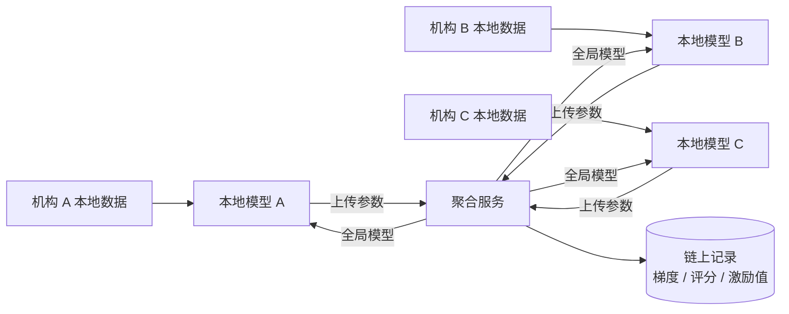

# 个性化联邦学习方案

## 1. 为什么需要联邦学习

大学生心理健康数据分散在**校医院、心理咨询中心、院系、合作医院**等多个机构，且属于敏感个人信息：

- 集中汇总建模 → 合规风险高、机构意愿低；
- 各家单独建模 → 样本少、模型泛化差，且难以处理非独立同分布（non-IID）数据。

平台采用**个性化联邦学习（pFL）**：**原始数据不出机构，只交换模型参数**，服务端聚合出全局模型后，各机构再基于本地数据做个性化适配。



## 2. 实验框架：PFLlib

实验基于开源库 [PFLlib](https://github.com/TsingZ0/PFLlib)（Zhang et al., arXiv:2312.04992）：

- 34 种 tFL / pFL 算法：FedAvg、FedProx、MOON、FedBN、Ditto、pFedMe、FedPer、LG-FedAvg …
- 3 种场景（标签分布倾斜、特征分布倾斜、数量倾斜）+ 14 个数据集
- 内置差分隐私（opacus）与 DLG 隐私攻击评估，可用于验证隐私强度

### 环境准备

```bash
git clone https://github.com/TsingZ0/PFLlib.git
cd PFLlib
conda env create -f env_cuda_latest.yaml
conda activate pfl

cd ./system
python main.py -data mnist -m cnn -algo FedAvg -gr 2000 -did 0
```

如需一次性跑完算法对比（含非 IID 鲁棒性实验），可直接执行本仓库的脚本：

```bash
cd PFLlib/system
bash <仓库路径>/federated-learning/experiments.sh mnist cnn 0
```

脚本覆盖 `FedAvg`、`FedProx`、`pFedMe`、`PerAvg`、`FedFomo`、`FedAMP`、`FedMTL`，
并额外以 `-cdr 0.5`（50% 机构掉线）复跑一组，模拟真实协作中的不稳定机构。

常用参数：

| 参数 | 含义 |
| --- | --- |
| `-data` | 数据集（如 `mnist`、`Cifar10`） |
| `-m` | 模型（如 `cnn`、`resnet`） |
| `-algo` | 算法（如 `FedAvg`、`FedProx`、`Ditto`） |
| `-gr` | 全局通信轮次 |
| `-nc` | 参与客户端数量 |
| `-lbs` | 本地批大小 |
| `-lr` | 本地学习率 |
| `-did` | 指定 GPU device id |

本项目中已生成过的场景数据包括 `Cifar10-250-06/07/08`、`mnist03/05/08` 等非 IID 划分，用于对比不同算法在异构数据下的表现。

## 3. 平台中的映射

| 联邦学习概念 | 平台中的落地 |
| --- | --- |
| 参与机构 | 校医院 / 心理中心 / 合作医院（对应前端的 `AgencyId`） |
| 本地模型 | 机构本地训练的模型，可在 `/admin` 中查看、训练、停止、验证、下载 |
| 全局 / 协同模型 | 聚合后的共享模型，机构可选择「加入全局」 |
| 个性化模型 | 「加入个性化」，在本地数据上继续适配 |
| 贡献与激励 | 每轮训练的**梯度、机构评分、激励值**上链，见 `/admin/model-detail/:id` |
| 任务大厅 | `/current` 展示当前联邦训练任务，机构可报名参与 |

## 4. 相关接口

| 接口 | 说明 |
| --- | --- |
| `GET /api/fisco/getData?AgencyId=` | 联邦任务与模型列表 |
| `GET /api/fisco/Model?GroupId&AgencyId&File_id&Round` | 下载指定轮次的模型 |
| `GET /api/fisco/getLength?AgencyId=` | 机构参与记录数量 |
| `POST /api/model/startTraining` | 发起新一轮联邦训练 |

## 5. 后续规划

- [ ] 将 PFLlib 训练流程封装为独立微服务，提供任务创建、进度查询、模型仓库能力；
- [ ] 接入差分隐私预算（DP）与 DLG 攻击评估，量化隐私保护强度；
- [ ] 与区块链激励合约联动，实现自动化的贡献结算。
